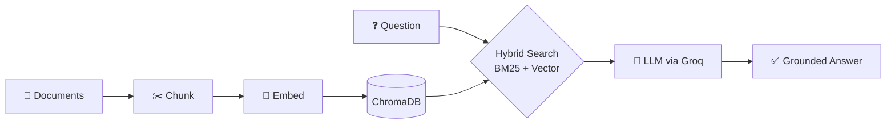

<!-- ============ HEADER ============ -->
<div align="center">


<a href="https://git.io/typing-svg">

</a>

<br/>


[](https://linkedin.com/in/om-kulkarni-)


</div>

---

## 🧠 `whoami`

```python
class Om:
    def __init__(self):
        self.role      = "Final-year B.E. student, AI & Data Science"
        self.college   = "D.Y. Patil College of Engineering, Akurdi, Pune"
        self.graduates = 2027
        self.target    = ["AI/ML Engineer", "GenAI Engineer"]
        self.superpower = "Turning messy documents into answers"
        self.fuel      = ["football", "cinematography", "hackathons", "chai"]

    def currently(self):
        return {
            "building":  "GenAI apps with RAG and LangGraph agents",
            "learning":  ["Java", "HyDE", "RAPTOR", "Self-RAG"],
            "looking_for": "a team that ships GenAI products",
        }
```

---

## 🛠️ Tech Arsenal

<div align="center">


<br/>


</div>

| Layer | What I use |
|:--|:--|
| 🤖 **GenAI** | LangChain, LangGraph, MCP agents, RAG pipelines, ChromaDB, Groq, HuggingFace embeddings |
| 📊 **ML** | scikit-learn, XGBoost, CatBoost, MLflow, DagsHub |
| ⚙️ **Backend** | FastAPI, Flask, Streamlit, PyQt6 |
| 🗄️ **Data** | MongoDB Atlas, SQL |
| 🧰 **Workflow** | Ubuntu, zsh, conda/venv, Git |

---

## 🔁 How I build RAG



---

## 🚀 Featured Projects

<table>
<tr>
<td width="50%" valign="top">

### 🤖 LangGraph Multi-Tool Agent
An agent that decides when to search **arXiv, Wikipedia or DuckDuckGo** to answer your question.

`LangGraph` `MCP` `Agents`

</td>
<td width="50%" valign="top">

### 💬 SQL Chat App
Ask your database questions in plain English. Dark, DataGrip-inspired UI. **100% success** on my test student database.

`LangChain` `Streamlit` `SQL`

</td>
</tr>
<tr>
<td width="50%" valign="top">

### 🎣 Phishing Detection Pipeline
End-to-end ML pipeline with experiment tracking and deployment. **~97% accuracy.**

`FastAPI` `MLflow` `MongoDB` `Docker`

</td>
<td width="50%" valign="top">

### 📚 LangChain Series (v1 → v4)
From a memory chatbot to document Q&A, hybrid search and finally an MCP agent. Four versions, one learning journey.

`LangChain` `ChromaDB` `HuggingFace`

</td>
</tr>
<tr>
<td width="50%" valign="top">

### 📡 vnstat-gui
A PyQt6 desktop app to monitor network usage on Ubuntu.

`PyQt6` `Linux`

</td>
<td width="50%"></td>
</tr>
</table>

---

## 📈 GitHub Stats

<div align="center">


<br/>


</div>

---

## 🌱 Fun Facts

- 🎬 I notice camera angles in movies more than the plot
- ⚽ I'll always have time for a football match
- 🏆 Hackathons are my favourite way to learn fast
- 💡 I believe a good README is half the project

---

## 📫 Let's Connect

<div align="center">

[](https://linkedin.com/in/om-kulkarni-)
[](https://github.com/justmeaprogrammer)

*If you're building something with GenAI, I'd love to chat.* ✨


</div>